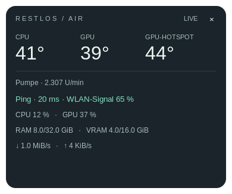
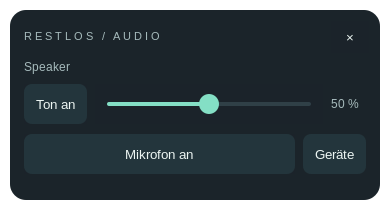

# Restlos Air

[](https://github.com/jurkast/restlos-air/actions/workflows/ci.yml)
[](LICENSE)

Ein kleines Temperatur- und Lüfter-Widget für Zorin OS. Restlos Air zeigt CPU, GPU,
Hotspot, Pumpendrehzahl, Auslastung, Speicherverbrauch und WLAN-Daten auf einem zweiten Bildschirm. Ein Klick auf die
Werte öffnet **Air Studio** mit den Einstellungen. Die Anwendung verwendet GTK 3
und den vorhandenen CoolerControl-Dienst.



Das passende **Audio-Widget** bietet Lautstärke, Mikrofon-Stummschaltung und
Gerätewechsel. Beide Widgets teilen sich einen Prozess und das Tray-Symbol.



Die Abbildungen zeigen die echte Oberfläche mit Beispielwerten.

[Download Version 1.1.1](https://github.com/jurkast/restlos-air/releases/tag/v1.1.1)
· [Fehler melden](https://github.com/jurkast/restlos-air/issues)

## Funktionen

- Rahmenloses Widget und Tray-Symbol, ohne normalen Taskleisteneintrag.
- Automatischer Start des Widgets beim Anmelden.
- CPU-, GPU- und Hotspot-Temperaturen; Lüfter- und Pumpendrehzahlen im Studio.
- Manuelle Lüfterleistung von 40 bis 100 % und drei editierbare Kennlinienpunkte.
- CPU-, GPU- oder gemeinsamer Kühlbedarf als Kennlinienquelle; 100 % spätestens bei 85 °C.
- Wiederherstellung der gesicherten vorherigen Regelung.
- Ping zum Router und zu 1.1.1.1; Anzeige des ICMP-Paketverlusts im Studio.
- Bildschirmwahl, Position und Anschlussnamen im Benutzerprofil.
- CPU-/GPU-Auslastung sowie verwendeter/gesamter RAM und Grafikspeicher.
- Aktive WLAN-Signalstärke und Empfangs-/Senderate der Standardverbindung.
- Audio-Widget mit Lautstärke von 0–100 %, Mikrofon, Ausgabegerät und Bildschirmwahl.

## Hardware-Unterstützung

Version 1.0.1 wurde mit **Zorin OS 18.1, X11, AMD Ryzen, einer AMD-Grafikkarte und
einem ASUS ROG STRIX B550-F GAMING mit NCT6798** geprüft. Restlos Air ist derzeit
auf dieses Hardwareprofil zugeschnitten; es ist keine universelle Lüftersteuerung.

Die lokale Temperaturanzeige verwendet `k10temp` und `amdgpu`. Regelbar sind nur
NCT6798-Anschlüsse 1, 2 und 3, wenn CoolerControl sie als regelbar erkennt und
aktuelle Temperatursensoren liefert. Die Grafikkartenlüfter und NCT-Kanal 6 bleiben
Anzeigen. Andere Sensorchips, Intel-/NVIDIA-Anzeigen und Wayland wurden für diese
Version nicht geprüft.

Der Standardname „DeepCool · Wasserpumpe“ für Kanal 6 stammt vom Referenzrechner
mit einer GAMMAXX L240 RGB. Die tatsächliche Verkabelung bestimmt die Zuordnung.
Vor einer Änderung muss klar sein, welcher Anschluss welchen Lüfter versorgt.
Umbenennen ändert die technische Freigabe nicht: Der Pumpenschutz bezieht sich auf
Kanal 6. Ein Verteiler kann mehrere Lüfter über einen gemeinsamen Kanal steuern;
0 U/min kann auch einen freien Anschluss oder ein fehlendes Drehzahlsignal bedeuten.

## Installation

Benötigt werden Python 3.10 oder neuer, GTK 3/PyGObject/Cairo, libsecret,
AyatanaAppIndicator, `iputils-ping`, `iproute2`, `pulseaudio-utils` (`pactl`) und **CoolerControl-Dienst ab 5.0.1**.
Audio funktioniert mit PulseAudio oder PipeWire-Pulse. Die optionale WLAN-Signalstärke
benötigt NetworkManager mit `nmcli`; ohne diesen Dienst bleiben Ping und Datenraten verfügbar.

1. Zuerst CoolerControl nach der
   [offiziellen Anleitung für Debian/Ubuntu](https://docs.coolercontrol.org/installation/debian)
   einrichten. Sein Dienst muss die Hardware erkennen. Restlos Air richtet selbst
   kein fremdes Paketrepository ein.
2. Das `.deb` und die `.deb.sha256` von der
   [Release-Seite](https://github.com/jurkast/restlos-air/releases/tag/v1.1.1) herunterladen.
3. Im Downloadordner prüfen und installieren:

```bash
sha256sum -c restlos-air_1.1.1_all.deb.sha256
sudo apt install ./restlos-air_1.1.1_all.deb
restlos-air
```

Das Paket ergänzt den Autostart, installiert das Tray-Symbol und lädt den
Mainboard-Treiber `nct6775` beim Booten. Der vorhandene CoolerControl-Dienst wird
aktiviert. Er wird bei der Installation nur neu gestartet, wenn der NCT-Sensor
erst durch das Laden des Treibers verfügbar wurde. Die App läuft als normaler
Benutzer. Zum reinen Betrachten der Werte benötigt ihre Oberfläche keine Rootrechte.

Falls eine Verbindung erforderlich ist, **Steuerung verbinden** im Studio öffnen
und das CoolerControl-Passwort im lokalen Dialog eingeben. Der eigene API-Zugang
liegt im Linux-Schlüsselbund; Passwort und Zugangsschlüssel stehen nicht in den
Einstellungsdateien. Die Verbindung geht an `127.0.0.1:11987`.

## Bedienung

Auf die Widgetwerte klicken, um die Einstellungen zu öffnen. Das Tray-Menü bietet
Widget, Einstellungen, Ausblenden und Beenden. Das Kreuz im Studio führt zurück
zum Widget; das Kreuz im Widget blendet es aus. **Strg+M** wechselt die Ansicht,
**Escape** schließt die große Ansicht beziehungsweise blendet das Widget aus.
Die Kühlregelung läuft im CoolerControl-Dienst weiter, wenn die Oberfläche endet.

Das Audio-Widget öffnet sich beim ersten Start ebenfalls. **Geräte** öffnet die
Auswahl für Ausgabe, Mikrofon und Bildschirm. Beim Wechsel zieht Restlos laufende
Audioverbindungen zum ausgewählten Gerät um; Audio-Monitorquellen sind nicht als
Mikrofon auswählbar. Die Schaltflächen zeigen den aktuellen Stummstatus. Ein Klick
wechselt ihn. Das Kreuz blendet Audio aus; **Audio-Widget öffnen** im Tray-Menü
oder Studio zeigt es wieder. Seine Position und Sichtbarkeit werden gespeichert.
Die App startet keine Mikrofonaufnahme. Bei fehlendem Audiodienst werden die
Regler deaktiviert und eine Meldung angezeigt.

Eine Lüftervorgabe wird erst über **Anwenden** übernommen. Fehlende, veraltete oder
ungültige Temperaturwerte blockieren neue Vorgaben. Manuelle Leistung wird als
Kennlinie mit Temperaturschutz im Dienst eingerichtet. **Vorherige Regelung** stellt
die gesicherte CoolerControl-Vorgabe wieder her. Gab es zuvor keine Softwarevorgabe,
wird der beim Dienststart vorgefundene Hardwaremodus wiederhergestellt; BIOS-Werte
werden nicht geändert.

Temperaturen werden jede Sekunde gelesen. Die Pumpendrehzahl kommt im Widget alle
zwei Sekunden aus dem vorhandenen Dienstcache, statt den NCT-Chip erneut abzufragen.
Lüfter-, PWM- und Hardwarekennlinien im Studio werden alle fünf Sekunden gelesen.
Ein fehlender Wert wird als „—“ angezeigt.

Auslastung und Speicher werden alle zwei Sekunden aus lokalen Linux-Dateien
gelesen. Die CPU-Auslastung benötigt zwei Messpunkte. WLAN-Signalstärke kommt
höchstens alle 15 Sekunden aus dem vorhandenen NetworkManager-Cache; Restlos
fordert keinen Scan an. Datenraten werden alle fünf Sekunden aus Bytezählern der
aktiven Standardschnittstelle berechnet. Sie zeigen den gesamten Interfaceverkehr,
einschließlich anderer Apps. Die erste Probe und ein Verbindungswechsel liefern
zunächst „—“. WLAN-Prozentwerte beschreiben Signalstärke, keine Datenrate.

Audio wird über einen schlafenden `pactl subscribe`-Prozess aktualisiert. Zusammengehörige
Ereignisse und Reglerbewegungen werden gebündelt; es gibt keine periodische
Audioabfrage im normalen Betrieb. Bei Ausfall wird mit wachsendem Abstand erneut
verbunden. Audio und Lüftersteuerung haben getrennte Hintergrundaufgaben.

Alle fünf Sekunden wird je ein kleines ICMP-Paket zum Gateway und zu `1.1.1.1`
gesendet. Das ist kein automatischer Spielserver-Ping. Paketverlust bezieht sich auf
die letzten bis zu zwölf Internetproben. „Keine Antwort“ kann eine ICMP-Sperre
bedeuten und beweist keinen Internetausfall. Die App führt keine WLAN-Scans durch.

## Aus dem Quellcode

Das Debian-Paket lässt sich ohne Rootrechte bauen:

```bash
git clone https://github.com/jurkast/restlos-air.git
cd restlos-air
/usr/bin/python3 scripts/build_deb.py
```

Das Ergebnis liegt unter `dist/`. `Installieren.sh` baut und installiert dieses
Paket über die lokale Linux-Berechtigungsabfrage. `Starten.sh` öffnet die
installierte Version, falls vorhanden, sonst die Oberfläche unter `app/`.

Tests und CI benötigen keine echte Lüfterhardware und wenden keine Vorgaben am PC an:

```bash
/usr/bin/python3 -m unittest discover -s tests -p 'test_*.py'
xvfb-run -a /usr/bin/python3 tests/gui_smoke.py
xvfb-run -a /usr/bin/python3 tests/audio_gui_smoke.py
```

Für den GUI-Test werden GTK 3/PyGObject, Cairo, libsecret und Xvfb benötigt.

## Prüfstand

Auf dem Referenzrechner wurden manuelle Vorgaben, eine eigene Kennlinie und die
anschließende Wiederherstellung tatsächlich geprüft. Der Autostart nach einem
Neustart wurde bestätigt. Backend-Fehlerfälle, Netzwerkzustände, Cache-Frische und
die native Oberfläche werden zusätzlich ohne echte Hardware getestet.

Im 30-Sekunden-Leerlauftest von Version 1.0.1 lag das optimierte Widget bei etwa **0,2 % eines
CPU-Kerns und 67,7 MiB RAM**. Das ist eine Messung auf einem Rechner und keine
garantierte Obergrenze. Eine erfolgreiche Installation kalibriert die Lüfter nicht
automatisch und bestätigt nicht die Verkabelung eines anderen Rechners.

## Dateien und Entfernen

- Programm: `/usr/lib/restlos-air`, Starter: `/usr/bin/restlos-air`.
- Einstellungen und Sicherungen: `${XDG_CONFIG_HOME:-~/.config}/restlos-air/`.
- Autostart: `/etc/xdg/autostart/restlos-air.desktop`.
- Treiberkonfiguration: `/etc/modules-load.d/restlos-air.conf`.

Vor dem Entfernen eine gewünschte Kühlregelung im Studio oder in CoolerControl
herstellen. `sudo apt purge restlos-air` entfernt die App, Autostart und ihre
Treiber-Ladekonfiguration. CoolerControl und persönliche Einstellungen bleiben
erhalten. Das Entfernen der Oberfläche setzt keine aktive Lüftervorgabe zurück.

## Lizenz

Restlos Air steht unter der [MIT-Lizenz](LICENSE). CoolerControl und die verwendeten
Systembibliotheken sind eigenständige Projekte mit eigenen Lizenzen.
